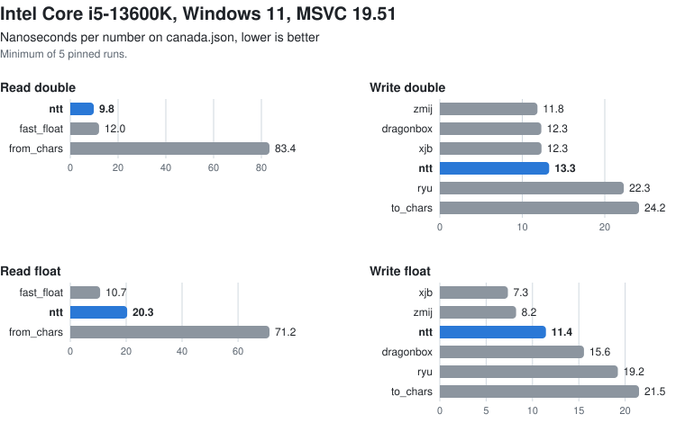
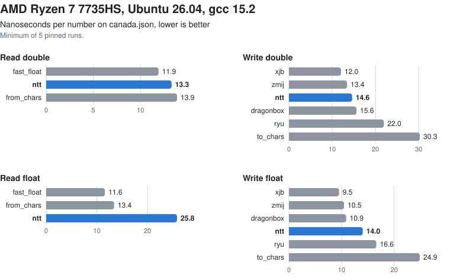
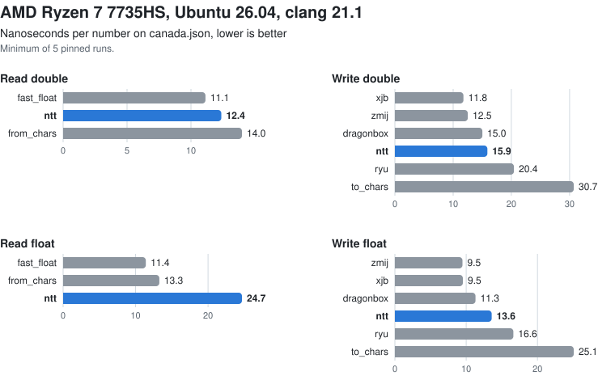
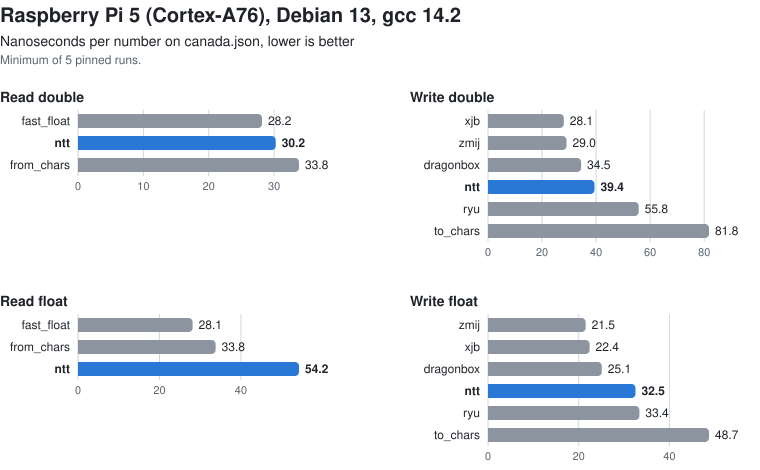

# NumberTextThree benchmarks

This suite times NumberTextThree against other libraries that read and write decimal numbers. While it does that, it also checks that every library gets every number right, so a fast but wrong result can't slip through.

## Building and running

The benchmarks are a separate CMake project. They take `NumberTextThree.h` from the parent directory and download the other libraries and `canada.json` at configure time, so the library's own build never sees any of this.

```bash
cmake -S Benchmarks -B out/bench
cmake --build out/bench
out/bench/Bench --pin 2 out/bench/data/canada.json
```

The build type defaults to Release, and CMake warns you if you pick another one, because the timings only mean something in a Release build. With a multi-configuration generator such as Visual Studio, build with `--config Release` and run `out/bench/Release/Bench`.

```
Bench [--runs N] [--pin CPU] [--count N] [--csv] [file ...]
```

- `--runs N` sets the number of timed runs, 5 by default. Each cell in the output shows the minimum and the median over those runs.
- `--pin CPU` keeps the benchmark on one logical CPU (on Windows and Linux).
- `--count N` sets how many numbers each synthetic set has, 100,000 by default.
- `--csv` prints comma-separated rows (`operation,dataset,library,numbers,min_ns,median_ns,disagreements`) instead of tables. The notes, the checks and the checksum go to standard error.
- `file` can be any text file, such as JSON or OGEX. The numbers in it become one more dataset.

The exit status is 0 when every check agrees, 1 when any of them disagrees, and 2 for a bad command line or a file that can't be read.

## What it prints

It prints one table per operation. The rows are datasets, the columns are libraries, and each cell holds the minimum and the median nanoseconds per number.

| Operation | What is timed | Libraries |
|---|---|---|
| read-f64 | text to double | ntt, fast_float, from_chars, strtod |
| write-f64 | double to text | ntt, zmij, xjb, ryu, dragonbox, to_chars, printf |
| read-f32 | text to float | ntt, fast_float, from_chars, strtof |
| write-f32 | float to text | ntt, zmij, xjb, ryu, dragonbox, to_chars, printf |
| write-int | u32, u64, i32 and i64 to text | ntt, to_chars |

These are the functions behind each column:

- **ntt**: `ntt_parse_json_f64`, `ntt_write_f64`, `ntt_write_f32`, and `ntt_write_u32` through `ntt_write_i64`. NumberTextThree can only read floats from an `ntt_decimal`, so for read-f32 the benchmark first splits the text into its digits and exponent and then calls `ntt_decimal_to_f32`. That split counts as part of the time.
- **fast_float**: `fast_float::from_chars`.
- **zmij**: `zmij::write`.
- **xjb**: `xjb_ftoa`.
- **ryu**: `d2s_buffered_n` and `f2s_buffered_n`.
- **dragonbox**: `jkj::dragonbox::to_chars_n`.
- **from_chars**, **to_chars**: `std::from_chars` and `std::to_chars`.
- **strtod**, **strtof**: the C library's own, in the C locale.
- **printf**: `snprintf` with `%.17g` for doubles and `%.9g` for floats. That always reads back to the same value, but it isn't the shortest text; 0.1, for example, comes out as `0.10000000000000001`.

`from_chars`, `to_chars`, `strtod` and `printf` come with the compiler, so they differ between MSVC, libstdc++ and libc++. The libraries also lay out their text differently (Ryu writes `1E0` and xjb writes `1.0`, for example). The checks don't look at the layout, only at the value.

## Datasets

The synthetic sets come from `std::mt19937_64` seeded with 20261031, so they are the same on every machine. Each set starts again from that seed.

| Dataset | Texts |
|---|---|
| random doubles | uniformly random 64-bit patterns, skipping infinities and NaNs, in their shortest text |
| random floats | the same for 32-bit patterns |
| short decimals | 1 to 6 significant digits with 0 to 6 decimals and a random sign, such as `0.25`, `-12.5` or `3` |
| 17 digits | exactly 17 significant digits, `d.dddddddddddddddde-30` to `e30`, with a random sign |
| integers | 1 to 15 digits with a random sign, so each one is exact as a double |
| coordinates | uniform in [-1000, 1000) with every bit of the double used, in their shortest text |
| canada.json | the numbers in `canada.json`, the coordinates of Canada's border |
| GridVertices.ogex | the numbers in a large mesh file, which is not distributed |
| u32, u64, i32, i64 | for write-int only: a uniformly random number of digits, then a uniformly random value with that many |

Reads are timed on the texts. Writes are timed on the values that `std::from_chars` reads from those same texts. The f32 operations only run on a dataset if every one of its texts is within the float range, so random doubles have no f32 rows; the header lists each dataset that was left out.

Numbers in files are found by a simple scanner. It skips quoted strings and picks up every number in JSON grammar, `-?(0|[1-9][0-9]*)(\.[0-9]+)?([eE][-+]?[0-9]+)?`, that isn't part of a word. In OGEX, for example, the 3 in `float[3]` counts, but the 1 in `node1` and the digits of `0x3F800000` don't. Numbers outside the double range are left out and counted in the header.

`canada.json` is downloaded at configure time from [nativejson-benchmark](https://github.com/miloyip/nativejson-benchmark), commit `478d5727c2a4048e835a29c65adecc7d795360d5`, file `data/canada.json`, and checked against its SHA-256, `f83b3b354030d5dd58740c68ac4fecef64cb730a0d12a90362a7f23077f50d78`. It ends up in `out/bench/data/`.

## Method

- Pinning. `--pin` keeps the benchmark on one logical CPU, using `SetThreadAffinityMask` on Windows and `sched_setaffinity` on Linux. The timings are only worth comparing when they come from a quiet machine.
- Interleaving. Each run times every library once on every dataset, one after the other, so if the machine has a slow moment it affects all the libraries alike instead of just one. The order of the libraries also rotates by one place from run to run.
- Minimum and median. Each timing covers at least 1,000,000 conversions, repeating the smaller sets as needed. The minimum over the runs is the best case with the least noise, and the median shows how steady the runs were.
- Nothing optimised away. Every read's bits and every write's length go into a checksum that is printed at the end. All writes go to the same 64-byte buffer, with a compiler barrier after each one, the same trick Google Benchmark's `DoNotOptimize` uses.
- The same build for everyone. Every library, ours and the third-party ones, is built with C++20, `-O2` or `/O2`, and `NDEBUG`. Warnings are treated as errors in the benchmark's own files only.

## Checks

Before any timing, every library converts every number of every dataset once, and the results are checked:

- reads must give the same bits as `std::from_chars`;
- written text must read back with `std::from_chars`, as a whole, to the same bits;
- integers must give the same text as `std::to_chars`.

The checks print how many disagreements each library had, and the first disagreement of each library on each dataset. A disagreement never takes a number out of the timing. MSVC's `strtod` rounds some inputs that lie exactly halfway between two doubles the wrong way, so on MSVC the long inputs can show `strtod` disagreements.

## Third-party code

CMake's `FetchContent` downloads each library into the build tree at a pinned commit. None of that code is part of this repository, and each library keeps its own license.

| Library | Upstream | Commit | Version | License |
|---|---|---|---|---|
| fast_float | https://github.com/fastfloat/fast_float | `42f254836ee416ffcf2f4e6576260003ac33d48c` | v8.3.2 | Apache 2.0, MIT or Boost 1.0 |
| Ryu | https://github.com/ulfjack/ryu | `4c0618b0e44f7ef027ebae05d2cc7812048f7c8f` | master, February 2026 | Apache 2.0 or Boost 1.0 |
| Dragonbox | https://github.com/jk-jeon/dragonbox | `beeeef91cf6fef89a4d4ba5e95d47ca64ccb3a44` | master, September 2025 | Apache 2.0 with LLVM exceptions, or Boost 1.0 |
| zmij | https://github.com/vitaut/zmij | `55ddf6aaccf922bfac289dece53d7ecc0540e314` | main, October 2026 | MIT |
| xjb | https://github.com/xjb714/xjb | `80cc89574a8f8457ffbf951afa2fd27c2459bd4a` | main, August 2026 | Apache 2.0 |

Dragonbox's last release, 1.1.3, is from 2022, so the benchmark uses its current master. xjb's `LICENSE` file and its source headers say Apache 2.0, while its README says MIT.

## Results

These are nanoseconds per number, so lower is better. Each number is the minimum of 5 runs pinned to one CPU of an otherwise quiet machine. The plots show canada.json, and the tables underneath show every dataset, with the fastest library in each row in bold.

### Intel Core i5-13600K, Windows 11, MSVC 19.51

`/O2 /DNDEBUG`, C++20.

<picture>
  <source media="(prefers-color-scheme: dark)" srcset="Results/i5-13600K-msvc-dark.svg">
  
</picture>

<details>
<summary>Every dataset</summary>

| read-f64 | ntt | fast_float | from_chars | strtod |
|---|---|---|---|---|
| random doubles | 25.7 | **24.9** | 140.7 | 164.3 |
| random floats | **20.9** | 22.7 | 77.1 | 86.3 |
| short decimals | 20.6 | **18.8** | 58.2 | 66.4 |
| 17 digits | **20.1** | 21.2 | 91.4 | 104.3 |
| integers | **13.3** | 17.1 | 34.0 | 38.1 |
| coordinates | **14.0** | 16.7 | 83.8 | 96.6 |
| canada.json | **9.8** | 12.0 | 83.4 | 93.1 |
| GridVertices.ogex | 10.5 | **10.3** | 48.5 | 63.6 |

| write-f64 | ntt | zmij | xjb | ryu | dragonbox | to_chars | printf |
|---|---|---|---|---|---|---|---|
| random doubles | 16.1 | **10.2** | 13.6 | 29.9 | 21.8 | 33.0 | 667.2 |
| random floats | 17.2 | **12.0** | 13.6 | 39.2 | 18.1 | 43.2 | 239.1 |
| short decimals | 14.4 | **11.7** | 15.3 | 42.1 | 18.7 | 48.5 | 206.3 |
| 17 digits | 17.1 | **12.5** | 15.5 | 29.8 | 24.0 | 36.4 | 233.0 |
| integers | 14.7 | **11.5** | 15.0 | 17.7 | 21.0 | 20.6 | 168.8 |
| coordinates | 13.3 | **11.7** | 16.1 | 24.4 | 18.0 | 28.0 | 213.7 |
| canada.json | 13.3 | **11.8** | 12.3 | 22.3 | 12.3 | 24.2 | 212.0 |
| GridVertices.ogex | 12.2 | 11.8 | 12.9 | 30.4 | **10.1** | 32.1 | 185.2 |

| read-f32 | ntt | fast_float | from_chars | strtof |
|---|---|---|---|---|
| random floats | 30.8 | **21.9** | 69.8 | 81.2 |
| short decimals | 28.6 | **18.4** | 53.8 | 66.1 |
| 17 digits | 27.4 | **19.7** | 78.5 | 94.7 |
| integers | 23.2 | **18.8** | 34.9 | 46.5 |
| coordinates | 25.8 | **15.3** | 75.5 | 87.0 |
| canada.json | 20.3 | **10.7** | 71.2 | 81.3 |
| GridVertices.ogex | 16.3 | **10.9** | 44.9 | 59.5 |

| write-f32 | ntt | zmij | xjb | ryu | dragonbox | to_chars | printf |
|---|---|---|---|---|---|---|---|
| random floats | 16.4 | 9.0 | **7.3** | 26.1 | 23.2 | 29.4 | 212.3 |
| short decimals | 13.3 | 8.7 | **7.4** | 33.9 | 24.5 | 39.8 | 178.5 |
| 17 digits | 17.0 | 9.3 | **7.3** | 27.5 | 24.2 | 31.4 | 204.4 |
| integers | 14.3 | 11.0 | **7.4** | 31.5 | 23.2 | 38.8 | 164.2 |
| coordinates | 11.4 | 8.2 | **7.3** | 22.6 | 16.9 | 25.9 | 183.5 |
| canada.json | 11.4 | 8.2 | **7.3** | 19.2 | 15.6 | 21.5 | 181.1 |
| GridVertices.ogex | 10.4 | 8.3 | **7.5** | 17.4 | 15.3 | 19.8 | 156.6 |

| write-int | ntt | to_chars |
|---|---|---|
| u32 | **9.8** | 11.6 |
| u64 | **14.1** | 18.9 |
| i32 | **12.5** | 14.0 |
| i64 | **16.1** | 20.8 |

</details>

### AMD Ryzen 7 7735HS, Ubuntu 26.04, gcc 15.2

`-O2 -DNDEBUG`, C++20.

<picture>
  <source media="(prefers-color-scheme: dark)" srcset="Results/ryzen-7735hs-gcc-dark.svg">
  
</picture>

<details>
<summary>Every dataset</summary>

| read-f64 | ntt | fast_float | from_chars | strtod |
|---|---|---|---|---|
| random doubles | 26.3 | **24.4** | 25.5 | 147.7 |
| random floats | 21.2 | **20.9** | 22.6 | 79.1 |
| short decimals | 21.0 | **17.3** | 17.7 | 56.4 |
| 17 digits | 22.6 | **20.3** | 21.5 | 99.7 |
| integers | **15.0** | 15.1 | 15.4 | 34.5 |
| coordinates | 16.7 | **15.9** | 18.1 | 78.1 |
| canada.json | 13.3 | **11.9** | 13.9 | 76.9 |
| GridVertices.ogex | 12.7 | **9.8** | 11.2 | 52.0 |

| write-f64 | ntt | zmij | xjb | ryu | dragonbox | to_chars | printf |
|---|---|---|---|---|---|---|---|
| random doubles | 18.6 | **11.0** | 11.7 | 28.6 | 20.6 | 35.0 | 366.0 |
| random floats | 18.7 | 12.2 | **11.8** | 37.7 | 17.1 | 46.5 | 219.9 |
| short decimals | 15.7 | 13.1 | **12.0** | 38.0 | 17.0 | 50.4 | 166.8 |
| 17 digits | 18.7 | 12.7 | **11.9** | 28.2 | 21.8 | 39.7 | 221.4 |
| integers | 15.1 | 12.7 | **12.1** | 15.5 | 18.9 | 29.2 | 171.7 |
| coordinates | 14.7 | 13.2 | **12.1** | 23.1 | 18.5 | 34.8 | 204.8 |
| canada.json | 14.6 | 13.4 | **12.0** | 22.0 | 15.6 | 30.3 | 202.4 |
| GridVertices.ogex | 13.5 | 13.1 | 12.0 | 29.0 | **11.9** | 39.3 | 131.7 |

| read-f32 | ntt | fast_float | from_chars | strtof |
|---|---|---|---|---|
| random floats | 29.3 | **21.6** | 23.3 | 77.7 |
| short decimals | 25.2 | **17.2** | 17.5 | 55.3 |
| 17 digits | 31.0 | **20.3** | 21.6 | 93.0 |
| integers | 18.8 | **17.4** | 18.0 | 36.3 |
| coordinates | 27.8 | **16.3** | 18.6 | 77.2 |
| canada.json | 25.8 | **11.6** | 13.4 | 76.0 |
| GridVertices.ogex | 16.6 | **11.0** | 12.4 | 50.7 |

| write-f32 | ntt | zmij | xjb | ryu | dragonbox | to_chars | printf |
|---|---|---|---|---|---|---|---|
| random floats | 19.6 | 10.4 | **9.6** | 23.0 | 17.7 | 32.5 | 177.6 |
| short decimals | 14.8 | 10.8 | **9.8** | 28.3 | 15.3 | 39.6 | 133.1 |
| 17 digits | 20.1 | 10.7 | **9.7** | 25.3 | 18.2 | 35.8 | 171.6 |
| integers | 15.8 | 12.3 | **9.9** | 28.2 | 15.8 | 48.7 | 158.3 |
| coordinates | 13.8 | 10.5 | **9.6** | 20.5 | 14.2 | 30.2 | 150.6 |
| canada.json | 14.0 | 10.5 | **9.5** | 16.6 | 10.9 | 24.9 | 147.1 |
| GridVertices.ogex | 12.2 | 10.5 | **9.6** | 15.4 | 10.9 | 24.6 | 92.8 |

| write-int | ntt | to_chars |
|---|---|---|
| u32 | **9.7** | 10.3 |
| u64 | **13.5** | 14.0 |
| i32 | **12.1** | 12.6 |
| i64 | **15.6** | 16.3 |

</details>

### AMD Ryzen 7 7735HS, Ubuntu 26.04, clang 21.1

`-O2 -DNDEBUG`, C++20.

<picture>
  <source media="(prefers-color-scheme: dark)" srcset="Results/ryzen-7735hs-clang-dark.svg">
  
</picture>

<details>
<summary>Every dataset</summary>

| read-f64 | ntt | fast_float | from_chars | strtod |
|---|---|---|---|---|
| random doubles | 24.7 | **23.4** | 25.3 | 147.9 |
| random floats | 20.3 | **19.8** | 22.5 | 79.0 |
| short decimals | 19.0 | **16.0** | 17.7 | 56.5 |
| 17 digits | 20.0 | **19.5** | 21.6 | 100.0 |
| integers | **13.0** | 13.6 | 15.3 | 34.6 |
| coordinates | **13.4** | 14.8 | 18.2 | 78.7 |
| canada.json | 12.4 | **11.1** | 14.0 | 77.4 |
| GridVertices.ogex | 11.3 | **8.2** | 11.3 | 52.5 |

| write-f64 | ntt | zmij | xjb | ryu | dragonbox | to_chars | printf |
|---|---|---|---|---|---|---|---|
| random doubles | 15.3 | 15.6 | **11.9** | 26.8 | 21.0 | 35.4 | 368.9 |
| random floats | 17.1 | 15.8 | **11.8** | 36.4 | 16.7 | 46.5 | 222.2 |
| short decimals | 15.4 | 12.5 | **11.8** | 38.7 | 17.5 | 50.9 | 167.9 |
| 17 digits | 17.2 | 15.6 | **11.8** | 26.5 | 22.3 | 40.1 | 222.7 |
| integers | 14.2 | 12.2 | **12.0** | 15.1 | 19.7 | 29.7 | 172.8 |
| coordinates | 15.6 | 12.6 | **11.5** | 21.6 | 18.2 | 35.2 | 204.9 |
| canada.json | 15.9 | 12.5 | **11.8** | 20.4 | 15.0 | 30.7 | 202.3 |
| GridVertices.ogex | 13.4 | 12.6 | 11.5 | 29.1 | **10.8** | 39.6 | 129.5 |

| read-f32 | ntt | fast_float | from_chars | strtof |
|---|---|---|---|---|
| random floats | 30.8 | **21.5** | 23.0 | 78.3 |
| short decimals | 26.2 | **16.8** | 17.4 | 56.7 |
| 17 digits | 32.3 | **20.2** | 21.4 | 93.5 |
| integers | 20.3 | **16.6** | 17.7 | 36.6 |
| coordinates | 26.1 | **15.9** | 18.5 | 77.5 |
| canada.json | 24.7 | **11.4** | 13.3 | 76.3 |
| GridVertices.ogex | 16.8 | **10.4** | 12.3 | 51.2 |

| write-f32 | ntt | zmij | xjb | ryu | dragonbox | to_chars | printf |
|---|---|---|---|---|---|---|---|
| random floats | 16.2 | 9.8 | **9.6** | 22.6 | 18.9 | 32.5 | 180.6 |
| short decimals | 13.8 | 9.9 | **9.6** | 27.4 | 16.4 | 39.9 | 135.3 |
| 17 digits | 17.0 | 10.2 | **9.6** | 24.7 | 19.5 | 35.8 | 174.6 |
| integers | 13.6 | 11.8 | **9.7** | 27.5 | 17.2 | 48.5 | 160.4 |
| coordinates | 13.3 | **9.4** | 9.5 | 19.9 | 15.3 | 30.3 | 151.5 |
| canada.json | 13.6 | **9.5** | 9.5 | 16.6 | 11.3 | 25.1 | 148.5 |
| GridVertices.ogex | 11.1 | **9.6** | 9.6 | 15.4 | 11.5 | 25.0 | 98.1 |

| write-int | ntt | to_chars |
|---|---|---|
| u32 | 8.5 | **7.8** |
| u64 | 11.8 | **11.6** |
| i32 | 11.0 | **9.7** |
| i64 | 13.7 | **13.6** |

</details>

### Raspberry Pi 5 (Cortex-A76), Debian 13, gcc 14.2

`-O2 -DNDEBUG`, C++20.

<picture>
  <source media="(prefers-color-scheme: dark)" srcset="Results/raspberry-pi-5-gcc-dark.svg">
  
</picture>

<details>
<summary>Every dataset</summary>

| read-f64 | ntt | fast_float | from_chars | strtod |
|---|---|---|---|---|
| random doubles | 58.3 | **50.0** | 53.0 | 375.8 |
| random floats | 47.6 | **44.4** | 49.2 | 165.0 |
| short decimals | 41.6 | **35.0** | 37.0 | 114.5 |
| 17 digits | 49.5 | **40.6** | 43.5 | 198.0 |
| integers | **27.0** | 31.3 | 33.0 | 75.4 |
| coordinates | 36.6 | **34.0** | 38.8 | 161.9 |
| canada.json | 30.2 | **28.2** | 33.8 | 177.4 |
| GridVertices.ogex | 30.0 | **22.7** | 27.5 | 115.5 |

| write-f64 | ntt | zmij | xjb | ryu | dragonbox | to_chars | printf |
|---|---|---|---|---|---|---|---|
| random doubles | 46.1 | **28.3** | 29.3 | 65.5 | 44.6 | 77.7 | 1409.0 |
| random floats | 44.6 | 29.7 | **28.8** | 103.2 | 35.4 | 118.7 | 592.9 |
| short decimals | 37.9 | 29.6 | **28.9** | 111.5 | 35.8 | 132.1 | 416.8 |
| 17 digits | 44.6 | 30.3 | **29.2** | 63.1 | 45.2 | 87.8 | 602.5 |
| integers | **28.8** | 29.4 | 28.9 | 33.6 | 39.1 | 54.7 | 448.6 |
| coordinates | 39.3 | 29.1 | **28.2** | 54.9 | 40.0 | 84.7 | 634.8 |
| canada.json | 39.4 | 29.0 | **28.1** | 55.8 | 34.5 | 81.8 | 606.2 |
| GridVertices.ogex | 37.6 | 29.1 | 28.9 | 94.6 | **28.3** | 112.6 | 339.9 |

| read-f32 | ntt | fast_float | from_chars | strtof |
|---|---|---|---|---|
| random floats | 60.4 | **45.6** | 50.8 | 159.8 |
| short decimals | 51.6 | **34.7** | 37.5 | 111.8 |
| 17 digits | 63.4 | **41.1** | 44.0 | 181.0 |
| integers | 44.2 | **35.2** | 37.9 | 79.1 |
| coordinates | 56.1 | **34.4** | 39.8 | 162.5 |
| canada.json | 54.2 | **28.1** | 33.8 | 178.6 |
| GridVertices.ogex | 40.2 | **24.8** | 30.4 | 115.7 |

| write-f32 | ntt | zmij | xjb | ryu | dragonbox | to_chars | printf |
|---|---|---|---|---|---|---|---|
| random floats | 39.6 | **21.8** | 22.4 | 43.2 | 34.0 | 61.3 | 452.3 |
| short decimals | 32.1 | **21.8** | 22.5 | 50.5 | 30.5 | 70.3 | 325.6 |
| 17 digits | 39.8 | **21.9** | 22.4 | 46.6 | 34.7 | 67.0 | 430.8 |
| integers | 30.2 | **22.2** | 22.4 | 53.7 | 31.2 | 101.5 | 417.8 |
| coordinates | 32.4 | **21.5** | 22.3 | 38.5 | 30.3 | 56.6 | 433.6 |
| canada.json | 32.5 | **21.5** | 22.4 | 33.4 | 25.1 | 48.7 | 426.1 |
| GridVertices.ogex | 30.7 | **21.6** | 22.6 | 32.2 | 26.0 | 48.3 | 257.6 |

| write-int | ntt | to_chars |
|---|---|---|
| u32 | **17.6** | 20.9 |
| u64 | **25.9** | 35.8 |
| i32 | **20.5** | 25.3 |
| i64 | **28.4** | 38.9 |

</details>
