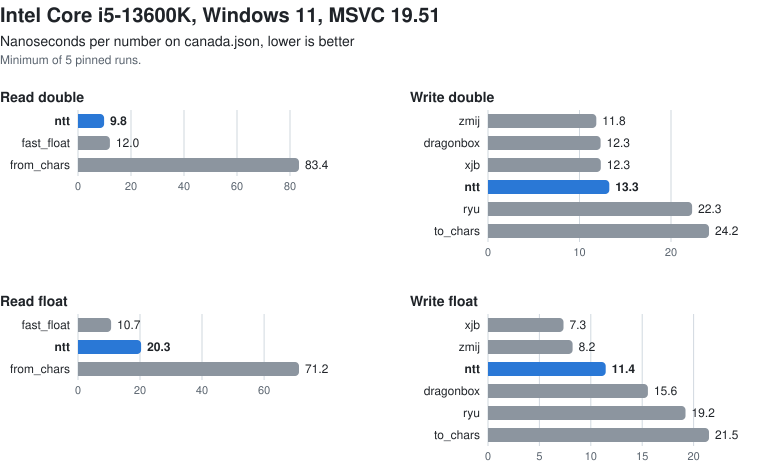

# NumberTextThree

NumberTextThree converts between decimal text and IEEE 754 numbers. It reads decimal text into doubles and floats, and it writes doubles, floats and integers back out as text. The whole library is a single C99 header.

What it aims for:

- Correct results. Every read gives the same double or float that exact big-integer arithmetic would give, rounding to nearest with ties to even. Every write produces the shortest digits that read back to the same value, which are the same digits you get from `std::to_chars`.
- Speed. The Eisel–Lemire algorithm settles more than 99% of real-world numbers without ever reaching the slower exact code, and Dragonbox writes every double and float without falling back to a slower method.
- No dependencies. In hosted builds the only includes are `<emmintrin.h>` on x86 and `<arm_neon.h>` on ARM64, and you can switch those off with `NUMBERTEXTTHREE_NO_SIMD`. The library doesn't allocate, keeps no global state and throws no exceptions, and every function is thread-safe.
- Portability. It compiles as C99 and as C++ with MSVC, gcc and clang, for 32-bit and 64-bit targets. All it needs is IEEE 754 doubles and floats and 64-bit integers. Because it uses integer arithmetic only, the results don't depend on the floating-point mode, so settings like `/fp:fast` can't change them.

## Using it

The simplest way is to copy `NumberTextThree.h` into your project and include it. If you use CMake, you can also bring in this repository with `add_subdirectory` or `FetchContent` and link to the `NumberTextThree::NumberTextThree` target. The version is available at compile time as `NUMBERTEXTTHREE_VERSION_MAJOR`, `NUMBERTEXTTHREE_VERSION_MINOR` and `NUMBERTEXTTHREE_VERSION_PATCH`.

```c
#include "NumberTextThree.h"

double      value;
const char* stop;
ntt_status  status = ntt_parse_json_f64( text, text + length, &value, &stop );

char    output[ NUMBERTEXTTHREE_F64_MAX_CHARS ];
ntt_i32 written = ntt_write_f64( value, output );
```

## The name

The *Three* in the name isn't a version number. It marks a generation, and the generations count down: after NumberTextThree comes NumberTextTwo, and then NumberTextOne, which will be the final generation.

Each generation has its own header, prefix and CMake target, so two generations can live side by side in one program. For this one they are `NumberTextThree.h`, `ntt_`, `NUMBERTEXTTHREE_` and `NumberTextThree::NumberTextThree`. The prefixes of the later generations are already decided, so they can never collide: `ntw_` for Two and `nto_` for One. Within a generation, releases follow semantic versioning, and this is NumberTextThree 1.0.0.

## API

### `ntt_status ntt_parse_json_f64( const char* begin, const char* end, double* value, const char** stop )`

Reads one number in strict JSON grammar, `-?(0|[1-9][0-9]*)(\.[0-9]+)?([eE][-+]?[0-9]+)?`, starting at `begin`. It never reads past `end`, so the text doesn't need to be terminated.

The status tells you what happened:

- `NUMBERTEXTTHREE_OK`: `*value` holds the correctly rounded double, and `*stop` points just past the number.
- `NUMBERTEXTTHREE_OUT_OF_RANGE`: the number is too large for a double, and `*value` is plus or minus infinity. Numbers that are too small to represent are not an error; they read as zero and return `NUMBERTEXTTHREE_OK`.
- `NUMBERTEXTTHREE_INVALID`: the text is not a JSON number. `*stop` points at the first character that doesn't fit the grammar, and `*value` is left unchanged.

You can pass a null `stop` if you don't need it.

### `ntt_status ntt_decimal_to_f64( const ntt_decimal* decimal, double* value )`

This one is for formats with a number syntax of their own. Your parser collects the digits and the exponent, and this function performs the rounding.

```c
typedef struct ntt_decimal
{
    const char* digits;   /* '0' to '9' only; leading zeros are allowed */
    ntt_i32     count;    /* 0 means the value zero */
    ntt_i64     exponent; /* the value is digits x 10^exponent */
    int         negative;
} ntt_decimal;
```

It accepts any number of digits and any exponent. The results and statuses are the same as for `ntt_parse_json_f64`, except that `NUMBERTEXTTHREE_INVALID` here means one of the characters in `digits` isn't a digit.

### `ntt_status ntt_decimal_to_f32( const ntt_decimal* decimal, float* value )`

Works like `ntt_decimal_to_f64`, but rounds to the nearest float in one step, with ties to even. It doesn't go through a double on the way, because rounding twice gets some inputs wrong.

### `ntt_i32 ntt_write_f64( double value, char* output )`

Writes `value` into `output` and returns the length of the text, not counting the terminating zero. `output` must have room for at least `NUMBERTEXTTHREE_F64_MAX_CHARS` (32) bytes. The writer may also touch bytes after the terminating zero, so the buffer needs the full size even when you know the text will be short. Infinity and NaN give an empty string and a length of 0, which leaves it to you to decide how to spell them.

The digits are the shortest ones that read back to the same double. When several candidates have that length, it picks the one closest to the value, with ties going to even, so you get the same digits as `std::to_chars`. Numbers from 1e-6 up to 1e21 are written in plain decimal, and anything outside that range in exponent form:

| value | output |
|---|---|
| 0.1 | `0.1` |
| 100 | `100` |
| 1e20 | `100000000000000000000` |
| 1e21 | `1e+21` |
| 0.000001 | `0.000001` |
| 1e-7 | `1e-7` |
| -0.0 | `-0` |
| 5e-324 | `5e-324` |

### `ntt_i32 ntt_write_f32( float value, char* output )`

The float version of `ntt_write_f64`. `output` needs at least `NUMBERTEXTTHREE_F32_MAX_CHARS` (24) bytes, the digits are the shortest that read back to the same float, chosen the same way, and the layout follows the same rules. For example, `0.1F` is written as `0.1`, and the largest float as `3.4028235e+38`.

### Integers

```c
ntt_i32 ntt_write_u32( ntt_u32 value, char* output );
ntt_i32 ntt_write_u64( ntt_u64 value, char* output );
ntt_i32 ntt_write_i32( ntt_i32 value, char* output );
ntt_i32 ntt_write_i64( ntt_i64 value, char* output );
```

Each of these writes the decimal digits of `value`, with a leading `-` for negative numbers, and returns the length without the terminating zero. `output` must hold at least `NUMBERTEXTTHREE_INTEGER_MAX_CHARS` (21) bytes.

## How it works

Reading uses the Eisel–Lemire algorithm, from Daniel Lemire's *Number Parsing at a Gigabyte per Second* (2021). Up to 19 significant digits are multiplied by a 128-bit approximation of the matching power of five, and in almost every case that one product is enough to decide the correctly rounded result. Longer inputs, extreme exponents, subnormal results, and the rare ambiguous products go to an exact conversion that works with big integers.

Writing uses Dragonbox, from Junekey Jeon's *Dragonbox: A New Floating-Point Binary-to-Decimal Conversion Algorithm* (2020). The upper end of the value's rounding interval is multiplied once by a 128-bit power of ten, taken from the same table the reader uses. Dividing the result by 1000 gives a quotient and a remainder, and between them they tell the shortest digits that read back, and the closest ones when there is more than one candidate. A second, partial product is needed only in the rare cases where the remainder lands right on the end of the interval or the next digit could be a tie. Powers of two are handled a little differently, because there the gap to the next value below is half the gap above, and the ends of the interval can be read off the power of ten. Every finite double goes through this path except zero and whole numbers below 2^53, which are simply written as integers.

The writer also avoids moving digits around. It converts the leading digits while the last digit is still being decided and puts them where the final layout wants them, so only the few digits in front of the decimal point ever have to move.

Floats share the reading code, with the float's fraction width, exponent range and rounding limits in place of the double's, and they are written by the same Dragonbox code as doubles.

Integers are written two digits at a time from a 200-byte table, in independent blocks of eight and four digits.

The floating-point writers turn sixteen digits into characters at a time with SIMD, following Wojciech Muła's article *SSE: conversion integers to decimal representation* (2011). With SSE2 they use the article's first algorithm, which goes back to Piotr Wyderski: it splits the digits inside one register by halving the lane width three times, first into groups of four, then into pairs, then into single digits. With NEON they use the article's second algorithm, which turns each group of four into digits in parallel lanes. On the reading side, the scanner checks eight characters at a time for digits, using a test by aqrit.

All of the code was written for this library. It follows the papers and articles above, Schubfach's logarithm constant as the Dragonbox paper gives it, Granlund and Montgomery's divisibility test (from *Hacker's Delight*), *Bit Twiddling Hacks* for the decimal length of an integer, and the ECMAScript rule for when to switch to exponent form. No code was taken from other implementations. One idea did come from one: writing the last digit separately from the rest, as xjb does.

The table holds 669 128-bit powers of five, from 5^-342 to 5^326. `Tools/GenerateTable.py` builds it with exact arithmetic and checks it along the way: the accuracy of every entry (the worst relative error is below 2^-127), how each entry is rounded, the three logarithm shortcuts the code relies on, and that the writer's last digit always stays below 10.

## Configuration

Two macros switch off the platform-specific parts:

- `NUMBERTEXTTHREE_NO_INTRINSICS` makes the library use portable 64-bit arithmetic for multiplication and bit counting instead of compiler intrinsics. Normally it uses `__umulh` and `_BitScanReverse64` with MSVC on x64 and ARM64, and `unsigned __int128` and `__builtin_clzll` with gcc and clang. This macro also turns off SIMD.
- `NUMBERTEXTTHREE_NO_SIMD` keeps the library from including `<emmintrin.h>` or `<arm_neon.h>`. Without it, hosted builds include `<emmintrin.h>` on x86-64, and on 32-bit x86 when SSE2 is enabled, and `<arm_neon.h>` on little-endian ARM64, so that the writers can produce sixteen digits at a time. Those compiler headers pull in parts of the C library, such as `malloc`, so code that uses such functions should include the proper headers itself rather than rely on ours. With this macro NumberTextThree includes nothing at all, which freestanding builds (`__STDC_HOSTED__` set to 0) already get by default.

## Tests

To build and run the tests:

```bash
cmake -S . -B out/release -DCMAKE_BUILD_TYPE=Release
```

```bash
cmake --build out/release
```

```bash
ctest --test-dir out/release --output-on-failure
```

- `CheckDouble` compares the written text with the shortest digits from `std::to_chars`, laid out as described above, and checks every read against both the exact code and `std::from_chars`. It generates the exact halfway points between neighbouring doubles and the numbers just around them, checks the grammar and the statuses, and makes sure nothing is written past `NUMBERTEXTTHREE_F64_MAX_CHARS`. You can give it a count for a deeper run (`CheckDouble 5000000`), and optionally a file of numbers to read, one per line.
- `CheckDoublePortable`, `CheckFloatPortable` and `CompileCPortable` run the same checks, built with `NUMBERTEXTTHREE_NO_INTRINSICS`.
- `CheckFloat` compares float reads with `std::from_chars` on exact halfway points and the numbers just around them, compares float output with the shortest digits from `std::to_chars`, and checks the integer writers against `std::to_chars`. Give it a count for a deeper run, or `every` to check the output for all 2^32 float bit patterns.
- `CompileC` builds and runs a small C99 program.
- `RoundTrip` and `CustomGrammar` are the two programs in `Examples/`. `RoundTrip` reads JSON numbers and writes them back out. `CustomGrammar` parses a number syntax of its own and leaves the rounding to `ntt_decimal_to_f64` and `ntt_decimal_to_f32`.

A few more things worth knowing:

- Run `CheckFloat every` before a release. Floats use Dragonbox with parameters outside what the published proof covers, so the exhaustive run is what shows they are right.
- Configuring with `-DNumberTextThreeEnableSanitizers=Yes` builds the tests with the address and undefined-behavior sanitizers.
- `Tools/GenerateHalfway.py` writes an independent set of halfway inputs, computed with Python's exact decimal arithmetic, which you can pass to `CheckDouble` as its file argument.
- The tests use `std::from_chars` as the reference rather than `strtod`, because MSVC's `strtod` rounds some exact halfway inputs the wrong way. With gcc and clang the two agree.

## Benchmarks

The `Benchmarks/` folder compares NumberTextThree with `std::from_chars` and `std::to_chars`, `strtod` and `printf`, fast_float, Ryu, Dragonbox and a few others, on synthetic data and on real-world files. It's a separate CMake project, so using the library never pulls in any of those dependencies. Its README explains the method and the commands, and has the results.

Here is how it looks on canada.json on one of the machines. The benchmarks README has the same plot for three more machines and compilers, along with the full tables for every dataset.

<picture>
  <source media="(prefers-color-scheme: dark)" srcset="Benchmarks/Results/i5-13600K-msvc-dark.svg">
  
</picture>

## License

You can use NumberTextThree under either of two licenses, whichever you prefer (SPDX: `CC0-1.0 OR 0BSD`):

- CC0 1.0 Universal. To the extent possible under law, Athanasios Iliopoulos has waived all copyright and related or neighboring rights to NumberTextThree. This work is published from: United States. See `LICENSE-CC0`.
- The BSD Zero Clause License (0BSD), for organizations and distributions that prefer an OSI-approved license. See `LICENSE-0BSD`.

Either way, you can use it for anything, and you don't owe anything, not even a credit. If it helps you, I'd appreciate a mention in your credits or a link back here, but that's entirely up to you.
